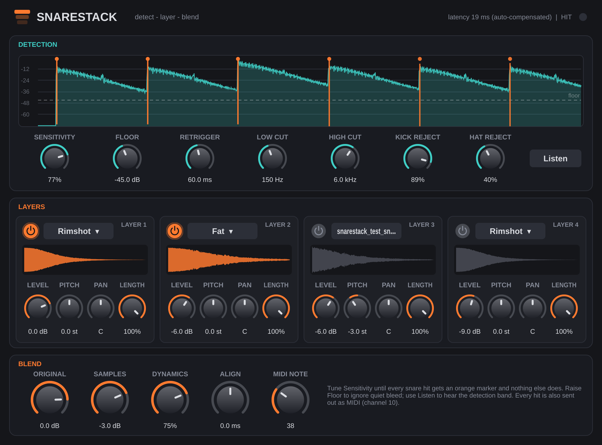

# SnareStack

A drum-replacement / drum-enhancement plugin in the spirit of Slate Trigger, focused on snare.
Put it on a snare track: it detects every hit, fires up to **four layered samples** on each one
(sample-accurately lined up with the original so nothing phases), and lets you **blend the layers
with the original track**. Every detected hit is also sent out as **MIDI**, so it doubles as a
snare-to-MIDI converter.



**For macOS**: an **Audio Unit** for Logic Pro (and GarageBand, MainStage), a **VST3** for other
Mac DAWs (Ableton Live, Reaper, Studio One, Cubase, Bitwig…), and a standalone app. One universal
build runs natively on Apple Silicon and Intel Macs, macOS 11 Big Sur or later. Built with JUCE 9.

---

## Getting it onto your Mac

### Option A — let GitHub build the installer (no developer tools needed)

1. Create a new (private is fine) repository on GitHub and upload this whole folder to it,
   including the hidden `.github` folder.
2. Open the repo's **Actions** tab. *Build SnareStack for Mac* runs automatically (or click
   **Run workflow**). It takes about 15 minutes, and checks the Audio Unit with Apple's `auval`
   validator, the same check Logic runs before it loads a plugin.
3. Download the **SnareStack-mac** artifact from the bottom of the run page. Inside is
   `SnareStack-0.1.0-mac.pkg`.
4. Double-click the `.pkg`. Because it isn't notarized by Apple, macOS will block it the first
   time: open **System Settings → Privacy & Security**, scroll down, click **Open Anyway**, and
   run the installer again. It installs:
   - `/Library/Audio/Plug-Ins/Components/SnareStack.component` (AU, for Logic)
   - `/Library/Audio/Plug-Ins/VST3/SnareStack.vst3`
   - `/Applications/SnareStack.app` (standalone)

(Push a tag like `v0.1.0` and the workflow also attaches the installer to a GitHub Release.)

### Option B — build it on your own Mac

Install Apple's command line tools (`xcode-select --install`) and CMake (`brew install cmake`), then
in this folder run:

```bash
./build-mac.sh              # builds and installs into ~/Library/Audio/Plug-Ins, then runs auval
./build-mac.sh --installer  # same, plus an installer .pkg in ./dist
```

To uninstall, delete `SnareStack.component` and `SnareStack.vst3` from the `Plug-Ins` folders
above (and from `~/Library/Audio/Plug-Ins` if you used Option B).

### First time in Logic Pro

Open Logic — it scans new Audio Units at launch. Insert SnareStack on your snare track from
**Audio Units → SnareStack → SnareStack**. If it's missing or marked as failed, open
**Logic Pro → Settings → Plug-in Manager**, select SnareStack, and click
**Reset & Rescan Selection**.

---

## Using it

1. Insert SnareStack on your **snare track** (or a snare bus). Out of the box, layer 1 ("Crack")
   and layer 2 ("Fat") are on, and the original is blended with them.
2. Watch the **Detection** display while the track plays. Each hit should get one orange marker.
   - Missing quiet hits / ghost notes → turn **Sensitivity** up or lower **Floor**.
   - Triggering on bleed → raise **Floor** (the dashed line) above the bleed, or narrow the band
     with **Low Cut** / **High Cut**. Press **Listen** to hear exactly what the detector hears.
   - Double triggers on one hit → raise **Retrigger**. For fast rolls, lower it (~35–40 ms) and
     raise Sensitivity.
3. Pick sounds per layer: click the name for the built-in snares (Crack, Fat, Tight, Rimshot) or
   **Load sample file…**, or just **drag a WAV/AIFF/FLAC onto a layer**. User samples are trimmed of
   leading silence and normalized, so they start right on the hit and are easy to balance.
4. Shape each layer with **Level**, **Pitch** (±12 semitones), **Pan** and **Length** (shortens and
   fades the sample — handy for tightening a long sample).
5. Blend: **Original** is your snare track, **Samples** is the sum of the layers. Go 100% samples for
   replacement, or keep the original up and tuck the layers underneath for enhancement.
   **Dynamics** decides how much the samples follow the drummer's playing (0% = every hit identical,
   100% = same dB swings as the original).
6. **Align** nudges the samples ±5 ms against the original. It's already sample-accurate, but if a
   layer's own transient is late (a sample with a soft attack) you can tighten it here — flip between
   settings and listen for the fullest, least "phasey" sound.

**Latency:** the plugin reports ~19 ms to the host so it can line samples up with the original.
Logic (and every other Mac DAW) compensates this automatically during playback and bouncing.
Logic's **Low Latency Mode** bypasses plugins with that much delay, so leave it off while mixing,
and don't monitor through SnareStack while recording.

### MIDI out

Each hit is sent as a note (default 38, GM snare) on MIDI channel 10, with velocity from the hit's
level, lined up with the original. Use it to drive any drum sampler, or to print the snare part as
MIDI. **Logic Pro and Ableton Live don't pass MIDI out of audio effects**, so in those, use the
built-in layers. On the Mac, Reaper, Bitwig, Cubase and Studio One can route it (use the VST3).

---

## Controls

| Section | Control | What it does |
|---|---|---|
| Detection | Sensitivity | How sharp a jump in level counts as a hit (higher = more sensitive) |
| | Floor | Ignore anything quieter than this (shown as the dashed line) |
| | Retrigger | Minimum gap between hits |
| | Low Cut / High Cut | The frequency band the detector listens to |
| | Kick Reject | Ignores "hits" that are louder below Low Cut than inside the band (kick bleed). 0% = off |
| | Hat Reject | Ignores "hits" that are much louder above High Cut than inside the band (hi-hat bleed). 0% = off |
| | Listen | Outputs the detection band so you can hear what's being analysed |
| Layers ×4 | On, Level, Pitch, Pan, Length | Per-layer sample settings; click the name to change the sample |
| Blend | Original / Samples | Level of your track and of the summed layers |
| | Dynamics | How much sample levels follow the original hit levels |
| | Align | Shift samples ±5 ms relative to the original |
| | MIDI Note | Note number sent for each hit |

---

## How the detection works

`Source/TransientDetector.h` (header-only, no JUCE dependency):

1. The input is band-limited by a 4th-order high-pass and low-pass (Low Cut / High Cut).
2. Every 2 ms the detector measures the energy of the *first-differenced* band signal — this
   emphasises the stick impact and wires over the ringing drum body, so a new hit stands out even
   on top of the previous hit's tail. A hit is a jump of at least the threshold over the average of
   the preceding hops, above the Floor.
3. The energy just below and just above the band is measured too; a "hit" dominated by those is
   kick or hat bleed and is rejected.
4. The onset is refined to the sample from a 1 ms envelope, corrected for the filters' group
   delay, and reported a bounded time later — which is why the plugin can report a fixed latency
   and start each sample exactly where the original hit leaves the plugin.

## Tests

Two test programs are included and run on every Mac build (`ctest`), followed by Apple's `auval`
Audio Unit validator and pluginval:

- `tests/detector_test.cpp` — synthesizes snare-mic tracks with ghost notes, kick and hi-hat bleed,
  human timing and room noise at 44.1/48/96 kHz, plus a 32nd-note roll. On the groove: all main hits
  detected, no false triggers once Floor is set above the bleed, every ghost note that isn't buried
  under a kick detected (≥89%), onset timing mean ≈0.2 ms / worst ≤0.6 ms. On the roll (with
  Sensitivity raised): 46–48 of 48 strokes, worst timing ≈3 ms.
- `tests/host_test.cpp` — drives the real plugin processor: the original passes through bit-exact
  (just delayed by the reported latency), triggered samples land on the original hits (mean ≈0.2 ms,
  worst ≤1.4 ms), MIDI notes line up, sample levels track the original's dynamics, Align works, user
  WAVs load at any sample rate, and all settings and sample choices restore from a saved project.
  Configure with `-DSNARESTACK_BUILD_HOST_TEST=ON` to build it.

## Known limitations (v0.1)

- A ghost note that lands at the same moment as a kick can be rejected as kick bleed. Turn
  **Kick Reject** down if you need those.
- Very fast buzz rolls, where each stroke is barely louder than the ring of the previous one, may
  need Sensitivity near max and a short Retrigger, and can still drop strokes.
- User samples are stored as file paths in your project. If you move or delete a sample file, the
  layer shows "Missing: …" — reload it from its new location.
- One velocity layer per slot (no round-robin or velocity-switched sample sets yet).
- The dynamics reference is the loudest recent hit, so the first couple of hits of a song may play a
  bit louder until it has heard a full-strength hit.
- The audio engine was tested headlessly; the Mac builds come from the workflow and haven't been run
  in Logic by me yet — please report anything odd.
- Not notarized by Apple (that needs a paid Apple Developer account), hence the one-time
  **Open Anyway** step.

## Licensing

SnareStack's own code is yours to use. It's built on JUCE, which is dual-licensed (AGPLv3 or a
commercial JUCE license) — fine for personal use; check JUCE's terms before distributing or
selling it. The built-in snares are synthesized in code, so there are no sample-license issues.
